# Project Report: Campus CareerTrack

## Student Placement & Internship Management System
**Laboratory Work Project (LWP) – Review 01**  
**Course:** Web Technology Laboratory  
**Department:** Computer Science and Engineering  
**Academic Year:** 2026–2027  

---

## 1. Introduction
Campus CareerTrack is an individual laboratory project developed for third-year B.E. Computer Science and Engineering students. It delivers a modern, responsive, and unified web application designed to streamline campus placement and internship recruitment.

In university environments, placement drives involve high volume, strict deadlines, specific eligibility benchmarks (e.g., minimum CGPA, backlog cutoffs, eligible batches), and multi-stage interview workflows. Campus CareerTrack offers a centralized, client-side digital interface where students can discover verified openings, assess their eligibility against company criteria, submit applications, manage bookmarks, and track application milestones from initial submission to final offer.

For Review 01, the system is engineered entirely using client-side web technologies (HTML5, CSS3, Vanilla JavaScript, and `localStorage`), providing complete functionality without requiring an external backend or database server.

---

## 2. Existing System and Its Limitations
In most college placement cells, the recruitment workflow relies on semi-manual and fragmented tools:
- **WhatsApp Groups and Telegram Channels:** Job notifications and interview schedules are broadcast as unstructured text or forwarded images, easily getting buried under student chat activity.
- **Static Notice Boards and PDF Circulars:** Company brochures and job descriptions are published as static PDFs on college portals, requiring manual reading and manual eligibility verification.
- **Google Sheets and Forms:** Students submit duplicate forms repeatedly for each drive, increasing clerical errors and making progress tracking impossible from the candidate's end.

### Major Limitations of Existing Approaches:
1. **No Real-Time Progress Visibility:** Students do not receive personalized status notifications or dashboard updates regarding shortlisting or interview scheduling.
2. **Eligibility Misalignment:** Many students apply for drives where they do not satisfy the minimum CGPA, batch, or backlog criteria, creating administrative overhead for placement officers.
3. **No Centralized Portfolio:** Students lack a standardized repository for their academic records, skill tags, and resume links.
4. **Poor Usability & Mobile Incompatibility:** Existing portals lack responsive design, dark mode, quick search, and interactive filtering.

---

## 3. Proposed System
The proposed **Campus CareerTrack** application replaces fragmented communication with a single, highly intuitive web application. 

### Key Highlights of the Proposed Solution:
- **Zero-Latency Client-Side Architecture:** Fast performance using Vanilla JavaScript and HTML5, requiring no server installation for Review 01 evaluation.
- **Dynamic Student Workspace:** Features a personalized dashboard with live counts for total applications, shortlisted profiles, scheduled interviews, and saved opportunities.
- **Interactive Eligibility Assessment:** An automated client-side calculation engine that verifies student CGPA, backlogs, batch, and disciplines against company cutoffs, accompanied by a skill-gap analysis.
- **End-to-End Application Tracking:** Full lifecycle management through `Applied`, `Shortlisted`, `Interview Scheduled`, `Selected`, and `Rejected` stages.
- **Demonstration State Switcher:** A dedicated evaluator control panel enabling instant simulation of status transitions during laboratory viva.
- **Persistent LocalStorage Layer:** Robust data persistence that survives browser reloads, complete with JSON serialization and auto-recovery from corrupted keys.

---

## 4. Objectives
- Design and construct a 10-page modern client-side web application following SaaS UI/UX best practices.
- Implement responsive multi-criteria filtering (location, work mode, job type, skills) and sorting across realistic company listings.
- Prevent duplicate applications to the same opportunity while maintaining an audit trail of submissions.
- Implement modal confirmation dialogs for destructive actions (withdrawing applications, resetting demo data).
- Ensure high usability across desktop (1440px), tablet (1024px/768px), and mobile (480px) viewports.
- Prepare a clean, modular code architecture designed for straightforward database and backend integration in Review 02.

---

## 5. Software and Hardware Requirements

### Software Requirements:
- **Operating System:** Windows 10/11, macOS, or Linux
- **Web Browser:** Modern standards-compliant browser (Google Chrome 110+, Mozilla Firefox 110+, Microsoft Edge 110+, or Safari 16+)
- **Editor / IDE:** Visual Studio Code, Antigravity IDE, or any standard text editor
- **Local Web Server (Optional):** Python `http.server`, VS Code Live Server, or direct file viewing

### Hardware Requirements:
- **Processor:** Dual-core 2.0 GHz or higher (Intel Core i3/i5/i7 or AMD Ryzen)
- **RAM:** 4 GB RAM minimum (8 GB recommended)
- **Disk Storage:** Under 20 MB for complete application source code and assets
- **Display Resolution:** 1280x720 minimum (1440x900 or 1920x1080 recommended for optimal dashboard presentation)

---

## 6. System Architecture

The application adopts a modular client-side Model-View-Controller (MVC) inspired architecture:

```mermaid
flowchart TD
    subgraph UI_Layer["Presentation Layer (HTML5 & CSS3)"]
        Landing["Landing Page (index.html)"]
        Dashboard["Dashboard (dashboard.html)"]
        Opportunities["Opportunities (opportunities.html)"]
        Details["Details (opportunity-details.html)"]
        Tracker["Tracker (applications.html)"]
        Profile["Profile (profile.html)"]
        Saved["Saved Jobs (saved-opportunities.html)"]
        Eligibility["Eligibility Checker (eligibility.html)"]
        Notifications["Notifications (notifications.html)"]
        Settings["Settings (settings.html)"]
    end

    subgraph Controller_Layer["Client-Side Controller Layer (Vanilla JS)"]
        AppJS["Core App & UI Framework (app.js)"]
        DashJS["Dashboard Controller (dashboard.js)"]
        OppJS["Opportunities Controller (opportunities.js)"]
        AppTrackJS["Applications Controller (applications.js)"]
        ProfJS["Profile Controller (profile.js)"]
        EligJS["Eligibility Engine (eligibility.js)"]
        NotifJS["Notifications Controller (notifications.js)"]
        SetJS["Settings Controller (settings.js)"]
    end

    subgraph Storage_Layer["Persistence Layer (Storage Engine)"]
        StorageEngine["Storage Module (storage.js)"]
        LocalStorage[("Browser LocalStorage API")]
    end

    UI_Layer <--> Controller_Layer
    Controller_Layer <--> StorageEngine
    StorageEngine <--> LocalStorage
```



---

## 7. Module Descriptions

### Module 1: Core Framework & Layout (`app.js`, `style.css`)
Provides the common UI foundation across all pages:
- Dynamic theme management (Light and Dark mode) saved to `localStorage`.
- Animated toast notifications (success, info, warning, error) with auto-dismiss progress bars.
- Accessible modal dialog system for confirmation prompts and the universal application submission form.
- Mobile drawer navigation and desktop sidebar collapse toggles.
- Centralized user avatar and notification badge synchronization.

### Module 2: Centralized Storage Engine (`storage.js`)
Serves as the single source of truth for the entire application:
- Defines standardized storage keys (`cct_student_profile`, `cct_opportunities`, `cct_applications`, `cct_saved_bookmarks`, `cct_notifications`, `cct_theme_preference`, `cct_app_settings`).
- Safely serializes and parses JSON structures with fallback initialization.
- Calculates dynamic statistics: total applications, shortlisted count, active interviews, saved count.
- Exposes methods for adding applications, updating statuses, toggling bookmarks, and resetting demo data.

### Module 3: Student Dashboard (`dashboard.html`, `dashboard.js`)
Aggregates key metrics for the student:
- Dynamic greeting and active placement semester badge.
- Four real-time metric cards that react to application changes.
- Recent applications feed and upcoming deadlines list.
- Recommendation cards matched to student skills.
- Custom SVG donut chart displaying the proportional distribution of application stages.

### Module 4: Opportunity Management & Details (`opportunities.html`, `opportunity-details.html`, `opportunities.js`)
- Comprehensive catalog of 12 realistic engineering opportunities across tech companies (Google, Microsoft, Razorpay, Swiggy, AWS, Zerodha, Cisco, CRED, PhonePe, Zomato, NVIDIA, Flipkart).
- Multi-criteria filtering by search query, location, work mode, job type, and interactive skill chips.
- Sorting by deadline (soonest/furthest), stipend/CTC (high-to-low), and job title.
- Dedicated detail view displaying responsibilities, technical requirements, selection rounds, and eligibility specifications.

### Module 5: Application Tracking & Demo Management (`applications.html`, `applications.js`)
- Tracks candidates through 5 lifecycle stages: `Applied`, `Shortlisted`, `Interview Scheduled`, `Selected`, `Rejected`.
- Status filter tabs with dynamic count badges and search filtering.
- Application withdrawal with styled modal confirmation.
- **Demonstration Control Panel:** An evaluator-facing widget enabling instant status switches during lab demonstrations, immediately reflecting across notifications, tracker tables, and dashboard charts.

### Module 6: Student Profile & Skills Hub (`profile.html`, `profile.js`)
- Structured editing of identity, college credentials, department, graduation year, CGPA, and backlogs.
- Interactive skills tag manager allowing students to add and remove skills with instant visual feedback.
- Dynamic profile completeness score meter with animated progress bar.
- Client-side mock resume file selector.

### Module 7: Role Eligibility Engine (`eligibility.html`, `eligibility.js`)
- Selects any target opportunity and loads published company cutoffs.
- Pre-fills student credentials from the profile while supporting &quot;what-if&quot; testing.
- Computes pass/fail checklists for CGPA, backlogs, batch, and disciplines.
- Performs skill gap analysis highlighting matched skills vs. recommended topics to learn.

### Module 8: Notifications Center (`notifications.html`, `notifications.js`)
- Log of categorized notifications (Status updates, Deadlines, Interviews, System alerts).
- Filter by All or Unread.
- Individual and bulk &quot;Mark as Read&quot; and &quot;Clear Notifications&quot; actions.
- Synchronizes with the unread counter badge in the top navigation bar.

### Module 9: Settings & Data Recovery (`settings.html`, `settings.js`)
- Light/Dark theme selector cards.
- Notification preference toggles.
- Data export button that compiles and downloads the full local storage state as a JSON backup file.
- Reset button to restore pristine sample demonstration data.

---

## 8. Technology Stack
- **HTML5:** Semantic document tags (`<header>`, `<nav>`, `<main>`, `<section>`, `<article>`, `<aside>`, `<footer>`), accessible form controls, ARIA attributes.
- **CSS3:** Custom Properties (CSS variables) for flexible theming, CSS Grid, Flexbox, smooth transitions, media queries, and keyframe animations.
- **Vanilla JavaScript (ES6+):** Arrow functions, template literals, destructuring, array methods (`map`, `filter`, `reduce`), DOM manipulation, event listeners, URL parameter parsing.
- **Web Storage API:** `localStorage` for cross-page client-side persistence without external database configuration.
- **Third-Party CDN Assets:** Font Awesome 6 for vector iconography; Google Fonts (Inter & Poppins) for typography.

---

## 9. Implementation Details

### Centralized Storage Schema Example
```javascript
// LocalStorage Key: 'cct_applications'
[
  {
    "id": "app-101",
    "oppId": "opp-1",
    "company": "Google",
    "role": "Software Development Engineer (SDE) Intern",
    "appliedDate": "2026-10-18",
    "status": "Shortlisted",
    "interviewDate": "2026-11-12 10:00 AM",
    "applicantName": "Priti Kumari",
    "applicantEmail": "priti.kumari@campus.edu",
    "notes": "Coding round cleared. Technical Interview Round 1 scheduled."
  }
]
```

### Prevention of Duplicate Applications
```javascript
hasApplied(oppId) {
  const applications = this.getApplications();
  return applications.some(app => app.oppId === oppId);
}
```

### Dynamic Dashboard Statistics Calculation
```javascript
getDashboardStats() {
  const applications = this.getApplications();
  return {
    totalApplications: applications.length,
    shortlistedCount: applications.filter(a => a.status === "Shortlisted").length,
    interviewCount: applications.filter(a => a.status === "Interview Scheduled").length,
    selectedCount: applications.filter(a => a.status === "Selected").length,
    savedCount: this.getBookmarks().length
  };
}
```

---

## 10. Testing Methodology

The application was systematically tested across critical user flows:

| Test Case ID | Test Scenario | Steps Taken | Expected Result | Actual Result | Status |
|:---|:---|:---|:---|:---|:---|
| **TC-01** | Landing Page Navigation | Click &quot;Explore Opportunities&quot; on `index.html` | Navigates to `opportunities.html` | Seamless page transition | **PASS** |
| **TC-02** | Search Filtering | Type &quot;Google&quot; in opportunity search input | Card list displays only Google | Only Google SDE Intern displayed | **PASS** |
| **TC-03** | Multi-Criteria Filter | Select Location: &quot;Bangalore&quot;, Mode: &quot;Remote&quot; | Filter cards matching both | Razorpay and Zerodha returned | **PASS** |
| **TC-04** | Bookmark Persistence | Click bookmark icon on an opportunity, refresh browser | Icon stays active; appears in Saved Opportunities | Stored in `localStorage`; persists after reload | **PASS** |
| **TC-05** | Application Submission | Click &quot;Apply&quot;, complete modal form, submit | Application recorded, toast displayed, status: Applied | Saved in storage; badge updated | **PASS** |
| **TC-06** | Duplicate Prevention | Attempt to apply to Google SDE role again | System blocks submission with warning toast | &quot;Already submitted application&quot; toast shown | **PASS** |
| **TC-07** | Demo Status Switcher | Select application, change status to &quot;Selected&quot; | Status changes; notification sent; dashboard stats update | Live synchronization verified | **PASS** |
| **TC-08** | Eligibility Checker | Enter CGPA 8.5 vs Google Min 8.0, check criteria | Returns &quot;Fully Eligible to Apply&quot; with criteria breakdown | Correct checklist rendered | **PASS** |
| **TC-09** | Profile Persistence | Edit profile name, change CGPA to 8.75, click Save | Profile saved; topbar avatar & name update; persists | Verified in `localStorage` | **PASS** |
| **TC-10** | Theme Toggle | Click theme toggle button | HTML data-theme switches to dark; persists on refresh | Dark styling correctly applied | **PASS** |
| **TC-11** | Reset Demo Data | Click &quot;Reset Demo Data&quot; in settings, confirm | Restores original 12 jobs, 4 applications, 3 bookmarks | Pristine initial state restored | **PASS** |

---

## 11. Current Limitations (Review 01 Prototype)
1. **Client-Side Storage Isolation:** Data saved in browser `localStorage` is scoped to the specific browser and machine; it cannot synchronize across separate devices.
2. **Simulated Authentication:** The current version provides a student workspace demonstration without server-side password hashing or multi-tenant database authorization.
3. **Local Resume References:** Resume attachment records the document filename rather than uploading multi-megabyte binary PDF files to a remote cloud bucket.
4. **Demonstration Dataset:** Job openings and recruiter schedules are curated mock records for laboratory evaluation rather than live corporate integrations.

---

## 12. Future Enhancements (Roadmap for Review 02)
- **Backend Architecture:** Migration to PHP 8.x or Java Servlets (Jakarta EE) with a RESTful routing layer.
- **Database Integration:** Implementation of a 3NF normalized MySQL database with relational foreign keys (`students`, `companies`, `opportunities`, `applications`, `interviews`, `notifications`).
- **Role-Based Authentication:** Multi-role access separating Student, Placement Officer, and Recruiter accounts with bcrypt password encryption.
- **Physical Resume Storage:** Server-side file upload handling with MIME validation, file size limits, and PDF viewer embedding.
- **Automated Email Notifications:** Integration with PHPMailer or JavaMail for real-time interview invitation emails.

---

## 13. Conclusion
Campus CareerTrack successfully fulfills all requirements for the third-year B.E. Computer Science and Engineering Web Technology Laboratory LWP Review 01 individual project. Built strictly using HTML5, CSS3, Vanilla JavaScript, and `localStorage`, the application demonstrates clean software engineering principles, intuitive UI/UX design, accessible navigation, and robust state persistence. It bridges the gap between academic lab requirements and production-grade frontend architecture, standing ready for full-stack database extension in Review 02.
